# ssh-config-audit

Every Linux server has an `sshd_config`, and most were last read the day they were installed. ssh-config-audit grades it against a hardening baseline, line by line, with the exact setting to change.



**Live demo:** https://jvch0512.github.io/ssh-config-audit/ (a report on a deliberately bad config in `examples/`)

Elixir, standard library only. Builds to a single `escript` file.

## Use

```bash
mix escript.build
./ssh-config-audit /etc/ssh/sshd_config
./ssh-config-audit sshd_config --html > report.html
./ssh-config-audit sshd_config --fail-below 75      # exit 1 in CI or a fleet scan
```

The report gives a grade (A to F), a score out of 100, and for each finding the line, the reason and the fix.

| Rule | Severity | Checks |
|---|---|---|
| SSH001 | critical | `PermitRootLogin yes` |
| SSH003 | critical | `PermitEmptyPasswords yes` |
| SSH004 | critical | SSH protocol 1 |
| SSH002 | high | password logins on, including when the setting is missing (the default is yes) |
| SSH008 | high | `PermitUserEnvironment yes` |
| SSH012 | high | host-based auth, `.rhosts` honoured |
| SSH013 | high | `StrictModes no` |
| SSH005 | medium | weak ciphers, MACs and key exchange, named one by one |
| SSH006 | medium | `X11Forwarding yes` |
| SSH007 | medium | `MaxAuthTries` above 4 |
| SSH009 | medium | `GatewayPorts`, `AllowTcpForwarding` |
| SSH010 | medium | `LogLevel` QUIET, FATAL or ERROR |
| SSH011 | medium | no `AllowUsers` or `AllowGroups` |

It follows OpenSSH's own rules: keywords are case-insensitive and the **first** value wins.

See [examples](examples) and [docs/sample-output.txt](docs/sample-output.txt).

## Limits

- Reads the file, not the running daemon. For the effective settings use `sshd -T`.
- `Match` blocks and `Include` files are not evaluated: parsing stops at the first `Match`.
- Defaults vary by OpenSSH version. The baseline assumes a current OpenSSH, so settings that old versions default differently may be reported when they are unset only where the default is unsafe (password authentication).
- It checks configuration, not whether keys, users and firewall rules around it are sound.

## Where it fits

Server hardening reviews, audit evidence (CIS-style controls), a quick fleet scan with `--fail-below`, and a fixed-price "SSH hardening review" service.

## Tests

```bash
mix test    # 15 tests
```

MIT.
